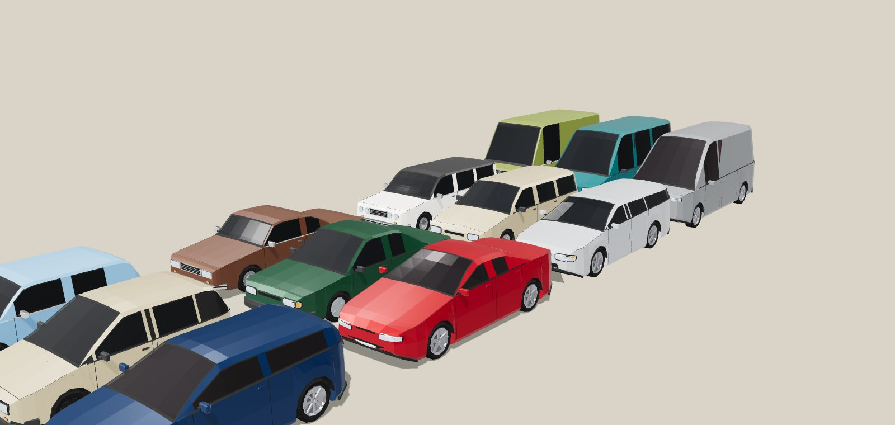

<p align="center">
  
</p>

<h1 align="center">BadChopShop</h1>

<p align="center">
  <b>Procedural, game-ready low-poly vehicles.</b><br>
  Vehicle type + era + seed = a reproducible, already-painted car (<code>.glb</code>) that a game can actually drive,<br>
  with doors, hood and trunk that open, and every part (engine, battery, exhaust, brakes…) as its own switchable piece.
</p>

<p align="center">
  <a href="https://badsadcode.github.io/BadChopShop/"><b>🎲 Visit the lot (playground)</b></a> ·
  <a href="https://badsadcode.github.io/BadChopShop/devlog/">📓 Logbook</a> ·
  <a href="docs/ARCHITECTURE.md">🧠 Architecture</a> ·
  <a href="docs/PROJECT_BRIEF.md">📜 Brief</a> ·
  <a href="docs/VEHICLE_INTERCHANGE_PROPOSAL.md">🔌 Vehicle contract</a>
</p>

*Bad Ideas Works: We Create Worlds. Badly. Now with traffic.*

---

## Status (honest version)

| Area | State |
|---|---|
| Types: hatchback (3/5-door), sedan, estate, panel van | ✅ working |
| Eras: seventies, nineties, modern (palettes, lamps, bumpers, rims, proportions) | ✅ working |
| Low-poly faceted look (Synty / Project Zomboid style), ~6–9k triangles with every part on; `detail: 'high'` for smooth | ✅ working |
| Hinged doors, hood, trunk/tailgate, sliding van door; windows ride on their doors | ✅ working (no door jambs behind them yet) |
| Separate parts: interior, engine, battery, exhaust, wheels, brakes, suspension, lights, mirrors, bumpers | ✅ working, each switchable or weldable |
| Markers: wheels (radius, steering, drive), seats, lamps, damage zones, exhaust, camera, engine sound | ✅ working |
| Noor Interchange output (`.glb` + `.noor.json` + `.recipe.json`), Khronos validator clean | ✅ 0 errors on every type × era |
| Deterministic: same recipe ⇒ byte-identical GLB | ✅ tested |
| Baltic Drive / NoorEngine / Godot / Unity / Unreal import | ⚠️ not tested in those yet |
| Delivery trucks, buses, military, tanks, sci-fi, every era | 🔜 the plan (see the brief) |

## Quick start

```bash
npm install
npm test                                     # build + validator, determinism, part toggles, manifest
node dist/cli.js generate sedan --style seventies --seed 4 --out out/
node dist/cli.js generate van --style modern --seed 2 --no interior,engine,battery,exhaust,suspension,brakes
node dist/cli.js generate hatchback --style nineties --seed 7 --welded panels,glass
node dist/cli.js batch --count 12 --out out/
npm run preview                              # playground at http://localhost:5173/tools/preview/
```

Each car is three files: `sedan_seventies_4.glb`, `sedan_seventies_4.noor.json` (the manifest: bounds, markers,
parts, suggested driving values) and `sedan_seventies_4.recipe.json` (rebuilds it exactly).

## What you get in the GLB

```
sedan_seventies_4
└─ Body                         shell, shut lines, cabin liner, Body-convcolonly (collision)
   ├─ Hood, Trunk | Tailgate    hinged (extras.noor: marker "door", axis, max, opens)
   ├─ Door_FL, Door_FR, …       hinged doors → Window_FL…, Mirror_L/R, handles
   ├─ Windshield, RearWindow, Window_QL/QR
   ├─ Lights_Front, Lights_Rear lamps by function: MAT_LightHead, MAT_LightBrake, MAT_LightIndicator, MAT_LightReverse
   ├─ Grille, Bumper_Front, Bumper_Rear (with number plates)
   ├─ Interior, Engine, Battery, Exhaust, Suspension_FL…
   ├─ Wheel_FL  (marker "vehicle.wheel": steering pivot at the hub; radius, width, steer, driven…)
   │   ├─ Wheel_FL_Hub      spins about X (tyre, rim) → Wheel_FL_Disc
   │   └─ Wheel_FL_Caliper  steers, doesn't spin
   └─ Seat_Driver…, Light_HeadL…, Zone_Engine/Battery/Fuel, Exhaust_FX, Camera_Chase, Sound_Engine (markers)
```

- **Space:** metres, +Y up, the front faces **+Z** (so +X is the car's left), pivot at the bottom centre on the ground.
- **Materials:** semantic slots (`MAT_Paint`, `MAT_Paint2`, `MAT_Trim`, `MAT_Chrome`, `MAT_Glass`, `MAT_Rubber`, `MAT_Rim`, …), shared and
  stable, so a game can repaint a car by changing one material. Lamps carry their "on" colour in `extras.noor.emissive_on`.
- **Opening:** a `door` marker opens by rotating `max` radians about `axis` (right-hand rule); positive always opens outward.

## Part of the family

BadChopShop is a sibling of BadGun, BadCharacters, BadMechs, BadShip and BadBuilding, all headed for **NoorForge**, the
Bad Ideas Works asset generator app. Its output follows **Noor Interchange** so it lands in NoorEngine as is, and it's
plain glTF for every other engine. The vehicle-specific bits are proposed for Noor Interchange v0.5 in
[`docs/VEHICLE_INTERCHANGE_PROPOSAL.md`](docs/VEHICLE_INTERCHANGE_PROPOSAL.md).
