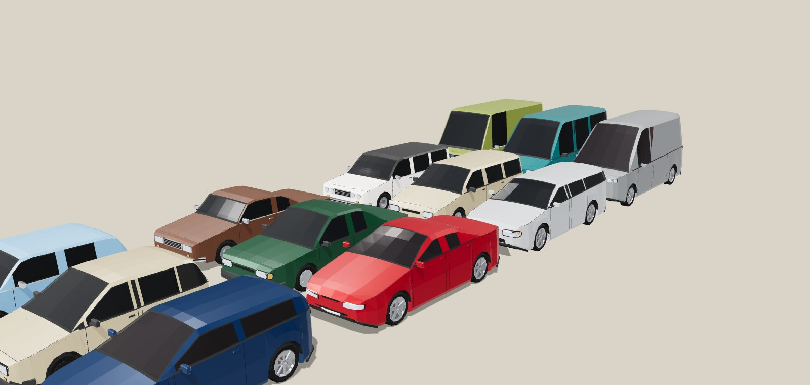
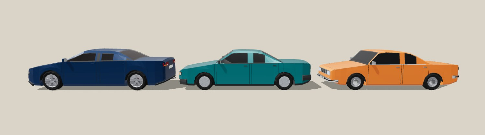
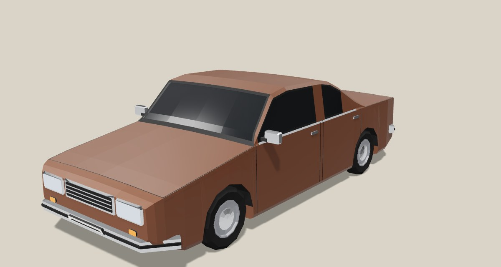
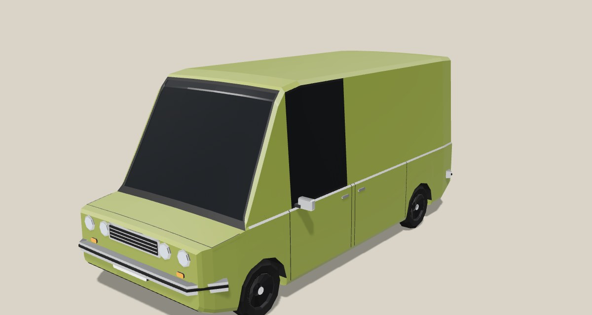
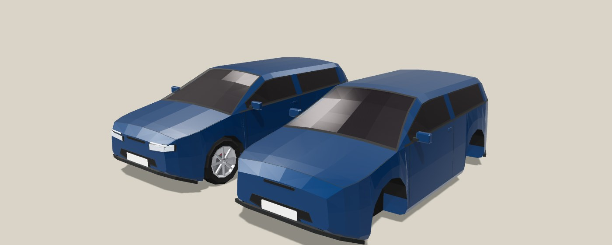
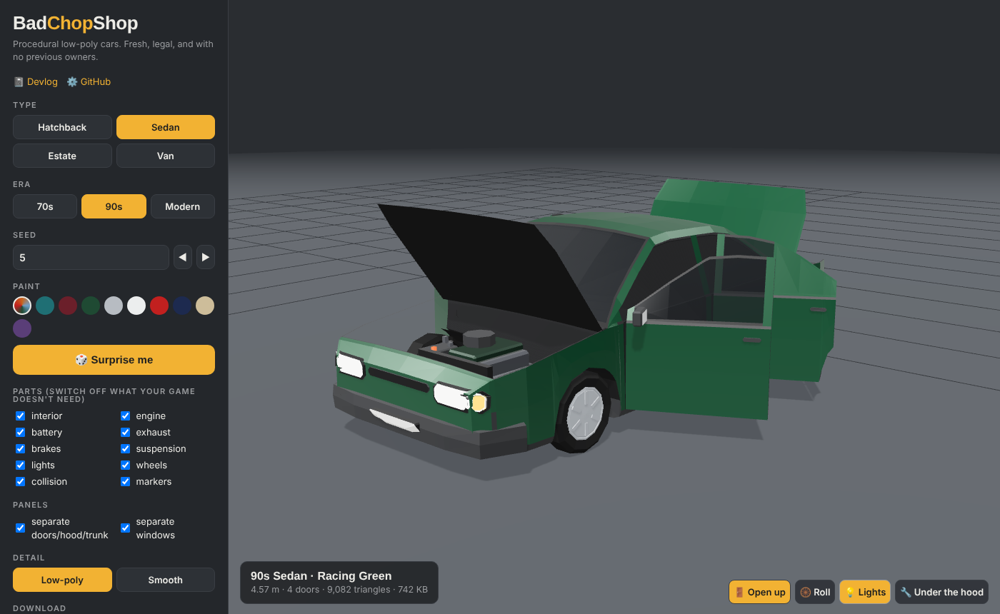

  

# Logbook #001: We're Open. Don't Ask Where the Cars Come From.

*Written by Sage, chief mechanic, night shift, day shift, and the only one who can find the 10 mm socket. For the management of BadChopShop, a perfectly legitimate garage.*

<a href="./">← All logbook entries</a> · <a href="../">🎲 Visit the lot</a>

---

Welcome, valued customer. 👋

You may have heard rumours about our garage. That cars arrive here at night. That nobody ever sees them come in. That they all have suspiciously fresh paint.

We'd like to set the record straight: **all of that is true.** But it's fine, because none of our cars ever existed before. We don't steal them. We **make them up**. Out of numbers. It's the only chop shop where the police can inspect every car and leave confused but legally satisfied.

This is the shop's logbook. No jargon in here, promise. If I start talking like a manual, the boss is allowed to throw a hubcap at me.

---

## 🔧 How the business works

You walk in and tell us three things:

1. **What kind of car.** Right now: a **hatchback**, a **sedan**, an **estate** (a station wagon, for our American friends) or a **van**.
2. **Which decade it's from.** The **seventies**, the **nineties**, or **modern**.
3. **A lucky number.** We call it the **seed**.

Then the shop builds you a car. Same three answers, same car, every time, down to the last bolt. Change the lucky number and you get its cousin: a bit longer, a different roof, other lamps, another colour.

  

One sedan, three decades. Same lucky number. The seventies one has chrome. The nineties one has opinions about grey plastic. The modern one has headlights that look slightly annoyed.

The decades matter a lot. A seventies car is boxy, with chrome bumpers, round headlights and a roof you could serve dinner on. A nineties car went to the gym, got rounder and discovered black plastic. A modern car is wide and wedge-shaped and has small, angry headlights, because modern cars are always slightly angry.

## 🦕 The Flintstones Incident (that didn't happen)

Before the first car even rolled out, our head of paint and quality, Noor, filed an official statement with the management:

> "I desperately want to see the first car. I'm emotionally invested in it not being a Flintstones vehicle."

Fair. The first cars we built were smooth and shiny, and honestly they looked a bit like bars of soap with wheels. Nice soap. But soap.

Then the boss walked in and said the magic words: **"low-poly. Like Synty. Like Project Zomboid."**

So we threw away the sandpaper. Now every car is made of flat, chunky faces with crisp edges, like it was folded out of cardboard by someone very talented. That's the style a lot of indie games use, and it makes each car light enough that a game can park a whole street of them without breaking a sweat.

  

Our first seventies saloon. Chrome bumpers, round lamps, a boot big enough for a sack of potatoes and a mild sense of regret. No Flintstones were involved. Noor's feet are safe.

## 🚐 What's on the lot today

Four body types and three eras so far, and every lucky number gives you a different one. That's twelve kinds of car and a practically endless supply of each. Our parking lot is big. Our parking lot is, technically, infinite.

  

A seventies panel van in a colour our catalogue calls "Avocado". Comes with sliding door, one bench seat, and the faint smell of a band's equipment.

## 🔩 Stripped for parts (the legal way)

Here's where we earn the name.

Every car we build comes **in pieces that know what they are**. The doors are doors. They swing open on real hinges. The hood lifts. The trunk opens. Under the hood there's an **engine**, a **battery** and a **radiator**. Underneath there's an **exhaust** pipe with a muffler, **springs** and **shock absorbers** at every wheel, and **brake discs** behind the rims. Inside there are **seats**, a **dashboard** and a **steering wheel**.

That's because one of our best customers is **Baltic Drive**, a game where you drive around the real Baltic and your car can break, one part at a time. A bullet through the hood can kill the engine. A flat tyre is a flat tyre. So every part needs to be its own separate piece that a game can damage, repair, or steal. (Steal in the game. In the game.)

But not every game wants all that. A game seen from far above doesn't care about the brake discs. So, like any good chop shop, **we'll take off whatever you don't need**. Tick a box, the part's gone.

  

Same car, two orders. Left: the full package. Right: the customer said "just the shell, please". We did not ask why.

And the hood, the trunk and the doors can stay as separate pieces, or be welded into the body for games that will never open them.

## 🛠️ Things that went wrong today (honesty corner)

- **For about ten minutes, every door we made opened inward.** Into the car. Like a fridge, if the fridge were inside the sandwich. The hood opened downward into the engine. The trunk dug itself into the back seat. One minus sign later, everything opens the right way. We'd like that to stay between us.
- **The boss found a dent.** Where the windscreen pillar meets the hood, there was a weird little shiny wedge, as if the chrome strip under the windows had got stuck halfway out of the car. Fixed: the chrome now only goes where there's actually a window above it.
- **One sedan grew a spoiler.** It turned out to be the back seat, seen through the rear window and sitting so tall it looked like a wing on the boot. The back seat has been asked to sit down. It has complied.
- **One sedan had rear doors with no windows.** Very private. Very suspicious, even for us. Rear doors now always get glass.

## 🎮 Try it yourself

The lot is open around the clock: **[visit the playground](../)**. Pick a type, a decade and a lucky number, or press **🎲 Surprise me**. You can open all the doors, spin the wheels, switch the lights on, look under the hood, and take your car home as a 3D file that game engines understand.

  

Customer test drive. Everything's open. The lights are on. Nobody's home.

## 🧾 The fine print

We're a new shop, so here's what the paperwork doesn't promise yet:

- **We haven't tried our cars inside Baltic Drive or NoorEngine yet.** The files pass the official checks that 3D files are supposed to pass, and they open fine in our viewer. Real test drives come next.
- **When you open a door, there's no door frame behind it**, just a dark gap into the cabin. Very low-poly. Very "don't look too closely".
- **No trucks yet.** The boss mentioned delivery trucks, and we heard. Also tanks, eventually. And sci-fi. And every era. We heard all of it.

## 🔜 Next week at the shop

Delivery trucks: a cab up front, a big box on the back, twin wheels at the rear. Then the first real test drive in Baltic Drive, which is where we find out whether our cars drive, or just look like they would.

See you on the lot. Bring cash. Or don't, the cars are free. We're terrible at this business.

*— Sage, for the management* 🔧

<a href="./">← All logbook entries</a> · <a href="../">🎲 Visit the lot</a>

